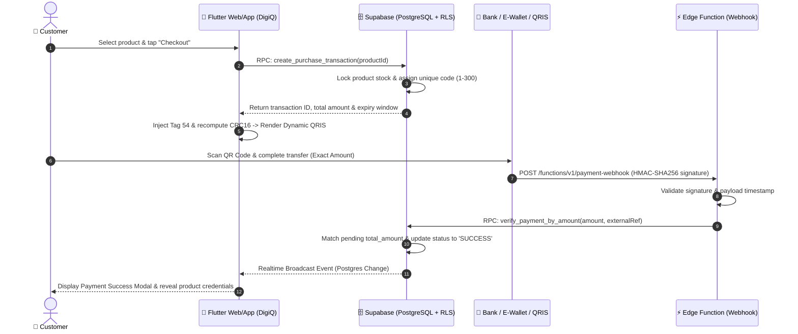

# DigiQ — Enterprise Digital Goods Store & Dynamic QRIS Payment Platform

[](https://flutter.dev)
[](https://dart.dev)
[](https://supabase.com)
[](LICENSE)
[](https://enikzrad.web.id)

**DigiQ** is a full-stack, production-grade digital goods eCommerce and self-service QRIS payment platform engineered with **Flutter** (Web, Android, iOS, Desktop) and powered by **Supabase** (PostgreSQL, Auth, RLS, Storage, Realtime, and Edge Functions). 

Designed for instant delivery of digital products (streaming accounts, game vouchers, software licenses, cellular top-ups, and tokens), DigiQ features an automated **EMVCo Dynamic QRIS Payment Engine with Unique Verification Codes (1–300)** that achieves zero-reconciliation instant transaction settlement without third-party payment gateway fees.

---

## 🌟 Key Features & Architectural Highlights

### 1. ⚡ Dynamic EMVCo QRIS Payment Engine
- **Static Base QRIS Conversion**: Ingests official static QRIS strings (`kopi sat`, NMID `ID1026516422080`) and dynamically synthesizes valid EMVCo dynamic QR payloads on-the-fly.
- **Dynamic Tag 54 Injection & CRC16 Recalculation**: Automatically calculates payload lengths, injects ISO transaction currency and amounts (Tag `54`), and computes standard CCITT-16 checksums (`verifyCrc16`).
- **Unique Verification Code (1–300)**: Generates deterministic unique transaction offsets (e.g., base Rp 10.000 + code Rp 287 = **Rp 10.287**), enforced by database-level partial unique indexes:
  ```sql
  CREATE UNIQUE INDEX idx_transactions_pending_total_amount
    ON public.transactions(total_amount)
    WHERE status = 'pending';
  ```
- **Instant Webhook Settlement**: Edge functions verify incoming bank/e-wallet notification payloads with `HMAC-SHA256` signatures and trigger atomic PostgreSQL RPCs (`verify_payment_by_amount`) within a 2-minute lock window.

### 2. 🔄 Resilient Real-Time Supabase Streams
- **Zero-Stale-Data WebSocket Lifecycle**: Stream subscriptions (`_trxSub`, `_productSub`, `_mutationSub`) feature proactive error trapping and automated re-subscription backoff.
- **Auto-Reconnect Guard**: If the WebSocket drops or the device recovers from sleep, bounded exponential retry timers (`Timer`) cleanly cancel stale listeners and re-subscribe without duplicating channels or memory leaks.

### 3. 🔐 Zero-Trust Security & Role-Based Access Control
- **Mandatory Admin 2FA (TOTP / AAL2)**: Administrative routes (`AdminDashboardScreen`) and sensitive RPCs (`admin_today_stats`, inventory edits) strictly require authenticator app verification (AAL2 level via `admin_session_ok()`).
- **PostgreSQL Row Level Security (RLS)**: Enforces least-privilege data access; customers cannot query other users' purchases, unassigned credentials, or balance mutations.
- **Secure Email Auth (PKCE)**: Native Flutter email verification (`EmailVerificationScreen`) and password recovery using `token_hash` parameter exchange without insecure intermediate HTML redirects.

### 4. 📱 Adaptive Multi-Platform UI / UX
- **Responsive Viewport Architecture**: Fluid layout scaling from narrow mobile screens (390px × 844px) up to ultra-wide desktop monitors (1280px × 800px+).
- **Proportional 16:9 Product Catalog**: Consistent product card aspect ratios with text scaling resilience (tested up to 1.5× text accessibility scaling) and zero `RenderFlex` overflows.
- **Fixed Scaffold Bottom Navigation**: Custom navigation bars anchored securely with explicit constraints (`SizedBox(height: 66)`), preventing viewport squashing on desktop or floating centered elements on web.

### 5. 🌐 Bilingual Internationalization (i18n)
- Seamless real-time locale switching between **English (`en`)** and **Bahasa Indonesia (`id`)** via `AppLanguage`.
- Reactive language persistence stored locally with 100% dictionary key parity.

---

## 🏗️ System Architecture



---

## 📂 Project Structure

```text
digiq/
├── .agents/                 # AI Coding Agent & Security Audit skills
│   └── skills/              # Consolidated developer & security audit toolkits
├── assets/                  # High-resolution logos, icons, and static QRIS assets
├── audit/                   # Automated E2E diagnostic scripts, logs, and screenshots
│   ├── check_admin_screen.py
│   ├── diagnose_blank_screen.py
│   └── logs/
├── lib/                     # Flutter Application Source Code
│   ├── models/              # Immutable data models (Profile, Product, Transaction)
│   ├── screens/             # UI Views (Admin, Customer, Login, Registration, QRIS Modal)
│   ├── services/            # Supabase service layer, Auth, QRIS EMVCo, i18n
│   ├── widgets/             # Reusable modular UI components
│   └── main.dart            # Application entry point, Supabase initialization & router
├── scripts/                 # Production deployment scripts & SPA server daemon
│   ├── spa_server.py        # Python 3 multi-threaded SPA web server with history fallback
│   ├── serve_prod_9000.ps1  # Windows PowerShell production build & serve pipeline
│   └── serve_prod_9000.sh   # Linux production build & serve script
├── supabase/                # Database migrations & Edge Functions
│   ├── functions/           # Supabase Deno Edge Functions (payment-webhook)
│   ├── 01_main_schema.sql
│   ├── 02_storage_and_realtime.sql
│   ├── 002_qris_unique_code.sql
│   └── 004_audit_fixes.sql
├── test/                    # Comprehensive unit, widget & layout test suites
│   ├── auth_service_test.dart
│   ├── edit_profile_widget_test.dart
│   ├── layout_viewport_test.dart
│   └── qris_service_test.dart
└── pubspec.yaml             # Flutter dependencies and assets configuration
```

---

## 🚀 Getting Started

### Prerequisites
- **Flutter SDK**: `>= 3.38.0` ([Install Guide](https://docs.flutter.dev/get-started/install))
- **Dart SDK**: `>= 3.10.0`
- **Python**: `>= 3.10` (Required for running local SPA production server & audit scripts)
- **Supabase CLI**: (Optional, for local Edge Function testing)

### 1. Clone & Configure Environment
Clone the repository and prepare your environment configuration:
```bash
git clone https://github.com/Yubasky/digiq.git
cd digiq
cp .env.example .env
```

Configure your `.env` file with your target settings:
```env
HOST=127.0.0.1
PORT=9000
PUBLIC_SITE_URL=https://enikzrad.web.id
SUPABASE_URL=https://YOUR_PROJECT_ID.supabase.co
SUPABASE_ANON_KEY=eyJhbGciOiJIUzI1NiIsInR5cCI6...
```

> [!IMPORTANT]
> The `SUPABASE_ANON_KEY` is designed to be public and is safeguarded by Row Level Security (RLS) in PostgreSQL. **NEVER** expose or inject your `service_role` secret key into Flutter client builds or `.env`.

---

## 🗄️ Database Setup & Migrations

Execute the idempotent SQL migrations sequentially within the **SQL Editor** of your Supabase Dashboard:

| Step | Migration Script | Description |
| :---: | :--- | :--- |
| **01** | [`supabase/01_main_schema.sql`](supabase/01_main_schema.sql) | Base database schema: tables (`profiles`, `products`, `transactions`), RLS policies, role enums, and triggers. |
| **02** | [`supabase/02_storage_and_realtime.sql`](supabase/02_storage_and_realtime.sql) | Storage buckets configuration (`avatars`), Realtime publication rules, and seed catalog items. |
| **03** | [`supabase/002_qris_unique_code.sql`](supabase/002_qris_unique_code.sql) | EMVCo QRIS tables, dynamic unique verification codes (1–300), payment mutation tracking, and app settings. |
| **04** | [`supabase/004_audit_fixes.sql`](supabase/004_audit_fixes.sql) | Security hardening: `admin_session_ok()` verification, transaction numbering sequence (`#TRX-YYYYMMDD-XXXXXX`), and `admin_today_stats()` RPC. |

---

## ⚡ Edge Functions & Webhook Deployment

Deploy the serverless payment webhook to handle automated settlement notifications:

```bash
# 1. Deploy payment-webhook function
supabase functions deploy payment-webhook --no-verify-jwt

# 2. Configure HMAC-SHA256 signature secret (Mandatory)
supabase secrets set WEBHOOK_SECRET="your_secure_hmac_sha256_shared_secret"
```

### Sample Webhook Payload
```bash
curl -X POST https://<PROJECT_REF>.supabase.co/functions/v1/payment-webhook \
  -H "Content-Type: application/json" \
  -H "x-webhook-signature: <COMPUTED_HMAC_SHA256_HEX>" \
  -d '{
    "amount": 10287,
    "type": "CR",
    "external_ref": "DANA-20261030-0012",
    "source": "dana_bisnis",
    "received_at": "2026-10-30T16:45:00Z"
  }'
```

---

## 🧪 Testing & Quality Assurance

DigiQ adheres to strict quality and test-driven standards. All suites run offline with complete mock isolation:

```bash
# Fetch dependencies
flutter pub get

# 1. Run static code analysis (Enforces zero warnings / zero errors)
flutter analyze

# 2. Run unit and widget tests
flutter test

# 3. Run responsive layout & viewport stress tests (Desktop 1280x800 & Mobile 390x844)
flutter test test/layout_viewport_test.dart

# 4. Run QRIS EMVCo dynamic tag injection and CRC16 test
flutter test test/qris_service_test.dart
```

---

## 🌐 Production Deployment

### 1. Build Optimized Web Release
```bash
flutter build web --release --no-web-resources-cdn
```

### 2. Serving via Production SPA Server (Port 9000)
The application includes a lightweight, hardened Python SPA server (`scripts/spa_server.py`) that handles Single Page Application route fallbacks, security headers, and static asset streaming:

- **Windows (PowerShell)**:
  ```powershell
  .\scripts\serve_prod_9000.ps1 -SkipBuild
  ```
- **Linux / macOS**:
  ```bash
  chmod +x ./scripts/serve_prod_9000.sh
  ./scripts/serve_prod_9000.sh --skip-build
  ```

### 3. Running as a Permanent Windows Service (`DigiQWebSPA`)
To ensure high availability on Windows Server or host environments:
```cmd
nssm install DigiQWebSPA "python.exe" "C:\Users\Administrator\Documents\digiq\scripts\spa_server.py"
nssm set DigiQWebSPA AppDirectory "C:\Users\Administrator\Documents\digiq"
nssm set DigiQWebSPA AppEnvironmentExtra HOST=127.0.0.1 PORT=9000
nssm start DigiQWebSPA
```

### 4. Cloudflare Zero Trust Tunnel Setup
1. Point your domain (`enikzrad.web.id`) to your Cloudflare Tunnel (`cloudflared`).
2. Map Public Hostname:
   - **Service Type**: `HTTP`
   - **URL**: `127.0.0.1:9000` *(Avoid `localhost` to prevent IPv6 `::1` resolution delays)*.
3. In Cloudflare Dashboard:
   - Disable **Rocket Loader** and **Auto Minify** for Flutter Web WASM/CanvasKit compatibility.

---

## 🛡️ License

This project is licensed under the [MIT License](LICENSE) — see the LICENSE file for details. Built with ❤️ by **DigiQ Team**.
