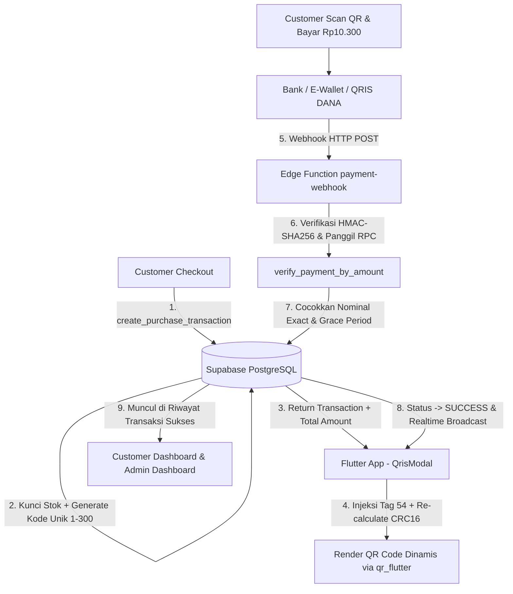

# DigiQ — Platform Pembelian Produk Digital & Pembayaran QRIS Mandiri

DigiQ adalah aplikasi mobile modern berbasis **Flutter** dan backend **Supabase (PostgreSQL, Auth, RLS, Storage, Realtime, Edge Functions)** untuk pembelian produk digital (akun streaming, voucher game, pulsa, token) yang dilengkapi sistem **PEMBAYARAN QRIS STATIS + KODE UNIK DENGAN VERIFIKASI MANDIRI**.

---

## 📌 Identitas QRIS Resmi Proyek
Sistem DigiQ menggunakan QRIS resmi merchant berikut:
- **Nama Merchant**: `kopi sat`
- **NMID**: `ID1026516422080`
- **Sub-ID / Terminal**: `A01`
- **Dicetak oleh (Acquirer NNS)**: `93600915` (Versi: `1.0.27.10.26`)
- **Raw String EMVCo Statis**:
  ```text
  00020101021126570011ID.DANA.WWW011893600915302435049402090243504940303UMI51440014ID.CO.QRIS.WWW0215ID10265164220800303UMI5204581353033605802ID5908kopi sat6015Kab. Nanggroe A6105245526304F95A
  ```
- **File Asset Gambar**: `assets/images/qris_kopi_sat.jpg` (didaftarkan di `pubspec.yaml`).

---

## 🏗️ Arsitektur Sistem



---

## 💡 Konsep Kode Unik & Verifikasi Mandiri
1. **Harga Produk + Kode Unik = Total Bayar**:
   - Contoh: Produk Rp10.000 + Kode Unik Rp300 = **Rp10.300**.
   - Kode unik (1 - 300) menjamin bahwa setiap transaksi berstatus `pending` memiliki nominal yang unik di seluruh platform.
2. **Partial Unique Index di Database**:
   ```sql
   CREATE UNIQUE INDEX idx_transactions_pending_total_amount
     ON public.transactions(total_amount)
     WHERE status = 'pending';
   ```
3. **Pelepasan Kode Unik Otomatis**:
   Kode unik dan stok produk otomatis dilepaskan kembali jika:
   - Pembayaran sukses diverifikasi.
   - Customer membatalkan pesanan (`cancel_my_pending_transaction`).
   - Transaksi kedaluwarsa setelah masa tenggang 2 menit (`expire_pending_transactions`).

---

## 🚀 Setup Database Supabase

Jalankan skrip migrasi SQL berikut secara berurutan di menu **SQL Editor** pada Supabase Dashboard:

1. **Skema Utama & Tabel Inti**:
   Jalankan file `supabase/01_main_schema.sql` (atau `supabase/digiq_schema.sql`).
2. **Konfigurasi Storage & Realtime**:
   Jalankan file `supabase/02_storage_and_realtime.sql`.
3. **Sistem QRIS Statis + Kode Unik & Mutasi**:
   Jalankan file `supabase/002_qris_unique_code.sql`.

Skrip telah dibuat **idempoten** (`IF NOT EXISTS`, `ON CONFLICT DO UPDATE`), sehingga aman dijalankan berulang kali.

---

## ⚡ Setup & Deploy Edge Function Webhook

Edge Function menerima notifikasi uang masuk dari forwarder notifikasi/mutasi bank atau e-wallet (DANA Bisnis, BCA, dll):

1. **Deploy Edge Function**:
   ```bash
   supabase functions deploy payment-webhook --no-verify-jwt
   ```
2. **Set Secret Environment**:
   ```bash
   supabase secrets set WEBHOOK_SECRET="kunci_rahasia_hmac_sha256_anda"
   ```
3. **Contoh Payload Webhook (cURL)**:
   ```bash
   curl -X POST https://<PROJECT_REF>.supabase.co/functions/v1/payment-webhook \
     -H "Content-Type: application/json" \
     -H "x-webhook-signature: <HMAC_SHA256_HEX>" \
     -d '{
       "amount": 10300,
       "type": "CR",
       "external_ref": "DANA-20261027-0099",
       "source": "dana_bisnis",
       "received_at": "2026-10-27T10:15:00Z"
     }'
   ```

---

## 🧪 Panduan Pengujian & Audit

Proyek telah melalui audit keamanan ketat dan pengujian 100% lulus:

### 1. Menjalankan Unit Test QRIS EMVCo
```bash
flutter test test/qris_service_test.dart
```
Menguji:
- Checksum CRC16 payload statis `kopi sat` valid (`F95A`).
- Injeksi nominal dinamis menghasilkan Tag `010212`, Tag `54`, nama merchant utuh, dan lolos validasi `verifyCrc16()`.

### 2. Menjalankan Seluruh Test Suite
```bash
flutter test
```
*Hasil: 11 dari 11 test lulus 100%.*

### 3. Static Code Analysis
```bash
flutter analyze
```
*Hasil: `No issues found!` (0 error, 0 warning).*

---

## 📂 Struktur Dokumentasi Modul (`tasks/`)
Detail desain teknis dan catatan audit tersimpan di folder `tasks/`:
- [`tasks/01-database-schema-rls.md`](file:///d:/PROJEK%20FAN%20DEV/digiq/tasks/01-database-schema-rls.md) — Skema database & RLS zero-trust
- [`tasks/02-auth-2fa-role.md`](file:///d:/PROJEK%20FAN%20DEV/digiq/tasks/02-auth-2fa-role.md) — Autentikasi, proteksi AAL2 (2FA) & role
- [`tasks/03-product-realtime-admin.md`](file:///d:/PROJEK%20FAN%20DEV/digiq/tasks/03-product-realtime-admin.md) — Katalog produk & sinkronisasi realtime
- [`tasks/04-transaction-rpc-stock.md`](file:///d:/PROJEK%20FAN%20DEV/digiq/tasks/04-transaction-rpc-stock.md) — Transaksi atomik & manajemen stok
- [`tasks/05-live-chat.md`](file:///d:/PROJEK%20FAN%20DEV/digiq/tasks/05-live-chat.md) — Fitur chat realtime customer-admin
- [`tasks/06-qris-static-unique-code.md`](file:///d:/PROJEK%20FAN%20DEV/digiq/tasks/06-qris-static-unique-code.md) — Sistem QRIS `kopi sat` & verifikasi mandiri
- [`tasks/07-audit-testing.md`](file:///d:/PROJEK%20FAN%20DEV/digiq/tasks/07-audit-testing.md) — Laporan audit keamanan & skenario pengujian
- [`tasks/README.md`](file:///d:/PROJEK%20FAN%20DEV/digiq/tasks/README.md) — Indeks tabel seluruh tugas proyek

---

## 🎨 Tema Desain DigiQ
- **Primary Cyan**: `#06ACDC` (Aksen utama DigiQ)
- **Rose**: `#E11D48` (Badge QRIS & status bahaya/cancel)
- **Emerald**: `#10B981` (Status sukses & approved)
