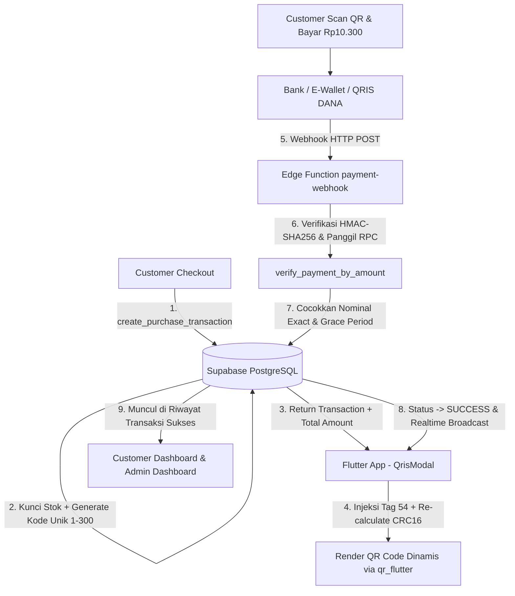

# DigiQ — Platform Pembelian Produk Digital & Pembayaran QRIS Mandiri

DigiQ adalah aplikasi mobile modern berbasis **Flutter** dan backend **Supabase (PostgreSQL, Auth, RLS, Storage, Realtime, Edge Functions)** untuk pembelian produk digital (akun streaming, voucher game, pulsa, token) yang dilengkapi sistem **PEMBAYARAN QRIS STATIS + KODE UNIK DENGAN VERIFIKASI MANDIRI**.

---

## 📌 Identitas QRIS Resmi Proyek
Sistem DigiQ menggunakan QRIS resmi merchant berikut:
- **Nama Merchant**: `kopi sat`
- **NMID**: `ID1026516422080`
- **Sub-ID / Terminal**: `A01`
- **Dicetak oleh (Acquirer NNS)**: `93600915` (Versi: `1.0.27.10.26`)
- **Raw String EMVCo Statis**:
  ```text
  00020101021126570011ID.DANA.WWW011893600915302435049402090243504940303UMI51440014ID.CO.QRIS.WWW0215ID10265164220800303UMI5204581353033605802ID5908kopi sat6015Kab. Nanggroe A6105245526304F95A
  ```
- **File Asset Gambar**: `assets/images/qris_kopi_sat.jpg` (didaftarkan di `pubspec.yaml`).

---

## 🏗️ Arsitektur Sistem



---

## 💡 Konsep Kode Unik & Verifikasi Mandiri
1. **Harga Produk + Kode Unik = Total Bayar**:
   - Contoh: Produk Rp10.000 + Kode Unik Rp300 = **Rp10.300**.
   - Kode unik (1 - 300) menjamin bahwa setiap transaksi berstatus `pending` memiliki nominal yang unik di seluruh platform.
2. **Partial Unique Index di Database**:
   ```sql
   CREATE UNIQUE INDEX idx_transactions_pending_total_amount
     ON public.transactions(total_amount)
     WHERE status = 'pending';
   ```
3. **Pelepasan Kode Unik Otomatis**:
   Kode unik dan stok produk otomatis dilepaskan kembali jika:
   - Pembayaran sukses diverifikasi.
   - Customer membatalkan pesanan (`cancel_my_pending_transaction`).
   - Transaksi kedaluwarsa setelah masa tenggang 2 menit (`expire_pending_transactions`).

---

## 🚀 Setup Database Supabase

Jalankan skrip migrasi SQL berikut secara berurutan di menu **SQL Editor** pada Supabase Dashboard:

| Urutan | File Migrasi | Deskripsi & Tujuan |
| :---: | :--- | :--- |
| **1** | [`supabase/01_main_schema.sql`](file:///d:/PROJEK%20FAN%20DEV/digiq/supabase/01_main_schema.sql) | Skema dasar (extensions, profiles, products, transactions, chat, RLS & triggers). |
| **2** | [`supabase/02_storage_and_realtime.sql`](file:///d:/PROJEK%20FAN%20DEV/digiq/supabase/02_storage_and_realtime.sql) | Storage bucket `avatars`, publication realtime, dan seed produk awal. |
| **3** | [`supabase/002_qris_unique_code.sql`](file:///d:/PROJEK%20FAN%20DEV/digiq/supabase/002_qris_unique_code.sql) | Konsep QRIS statis (`kopi sat`), kode unik dinamis, `app_settings`, mutasi pembayaran. |
| **4** | [`supabase/004_audit_fixes.sql`](file:///d:/PROJEK%20FAN%20DEV/digiq/supabase/004_audit_fixes.sql) | Perbaikan audit: helper `admin_session_ok()`, TRX sequence (`#TRX-YYYYMMDD-000001`), fallback `external_ref`, dan RPC `admin_today_stats()`. |

> [!NOTE]
> Jika database Anda sudah pernah menjalankan migrasi 01, 02, dan 002 sebelumnya, Anda hanya perlu menjalankan [`supabase/004_audit_fixes.sql`](file:///d:/PROJEK%20FAN%20DEV/digiq/supabase/004_audit_fixes.sql). Seluruh skrip bersifat **idempoten** (`IF NOT EXISTS`, `ON CONFLICT DO NOTHING / UPDATE`).

---

## 🔐 Setup Autentikasi 2FA TOTP (Wajib Admin)

Untuk menjamin keamanan tingkat tinggi pada operasional administrasi:
1. **Aktifkan MFA di Supabase Dashboard**:
   - Buka **Authentication** ➔ **MFA**.
   - Pastikan opsi **App Authenticator (TOTP)** berstatus **Enabled**.
2. **Alur Kerja Admin di APK DigiQ**:
   - Saat admin login via email & password, aplikasi otomatis memverifikasi faktor TOTP.
   - Jika admin belum pernah mendaftar TOTP: dialog aktivasi otomatis muncul dengan QR Code resmi (`qr_flutter`) dan Secret Key (dapat disalin) untuk Google Authenticator / Authy.
   - Admin memasukkan kode 6 digit untuk validasi awal.
   - Setelah sukses diverifikasi, sesi naik ke level **AAL2**.
   - Admin tidak dapat mengakses [`AdminDashboardScreen`](file:///d:/PROJEK%20FAN%20DEV/digiq/lib/screens/admin_dashboard_screen.dart) maupun menjalankan RPC admin sebelum verifikasi AAL2 terpenuhi (`admin_session_ok()`).

---

## ⚡ Setup & Deploy Edge Function Webhook

Edge Function menerima notifikasi uang masuk dari forwarder notifikasi/mutasi bank atau e-wallet (DANA Bisnis, BCA, dll):

1. **Deploy Edge Function**:
   ```bash
   supabase functions deploy payment-webhook --no-verify-jwt
   ```
2. **Set Secret Environment (WAJIB)**:
   ```bash
   supabase secrets set WEBHOOK_SECRET="kunci_rahasia_hmac_sha256_anda"
   ```
   > [!IMPORTANT]
   > Webhook menerapkan prinsip *fail-closed*: jika `WEBHOOK_SECRET` belum dikonfigurasi di Supabase Secrets, webhook langsung mengembalikan HTTP 500 `"Secret not configured"` sebelum memproses payload apa pun. Header `x-webhook-signature` wajib disertakan pada setiap request (HTTP 401 jika kosong atau tanda tangan tidak cocok).

3. **Contoh Payload Webhook (cURL)**:
   ```bash
   curl -X POST https://<PROJECT_REF>.supabase.co/functions/v1/payment-webhook \
     -H "Content-Type: application/json" \
     -H "x-webhook-signature: <HMAC_SHA256_HEX>" \
     -d '{
       "amount": 10300,
       "type": "CR",
       "external_ref": "DANA-20261027-0099",
       "source": "dana_bisnis",
       "received_at": "2026-10-27T10:15:00Z"
     }'
   ```

---

## 📧 Setup Verifikasi Email & Deep Link Redirect (Gmail - 100% Pure Dart)

Sistem pendaftaran pengguna DigiQ dilengkapi verifikasi email PKCE via Gmail dengan penukaran token dan tampilan konfirmasi 100% murni Flutter Dart Widgets:

1. **Atur Redirect URLs di Supabase Dashboard**:
   - Buka **Authentication** ➔ **URL Configuration**.
   - Tambahkan URL berikut di daftar **Redirect URLs**:
     * `digiq://auth-callback` (Wajib untuk custom scheme deep link APK DigiQ)
     * `digiq://login-callback` (Untuk login OAuth Google)
2. **Alur Kerja Murni Dart**:
   - Ketika tautan aktivasi di Gmail diklik, Android langsung memicu custom scheme `digiq://auth-callback`.
   - SDK `supabase_flutter` menukar PKCE code menjadi sesi aktif di dalam APK.
   - Layar konfirmasi [`EmailVerificationScreen`](file:///d:/PROJEK%20FAN%20DEV/digiq/lib/screens/auth/email_verification_screen.dart) menampilkan status sukses (`VerificationStatus.verified`) dengan ikon centang Emerald `#10B981` dan countdown 3 detik otomatis menuju Beranda.
   - Tidak diperlukan hosting file HTML perantara atau template eksternal.

---

---

## 🌐 Deployment via Cloudflare Zero Trust Tunnel (Port 9000)

Proyek DigiQ dirancang untuk disajikan secara cepat dan aman di domain publik **`https://enikzrad.web.id`** menggunakan arsitektur **Release Build Flutter Web + SPA Server (Python 3/ThreadingHTTPServer)** di port `9000`, yang diteruskan melalui **Cloudflare Zero Trust Tunnel (`cloudflared`)**.

```
[Customer Browser] ──HTTPS──> [Cloudflare Edge: https://enikzrad.web.id]
                                      │ (cloudflared encrypted tunnel)
                                      ▼
                        [Server Lokal: http://127.0.0.1:9000]
                                      │
                         [scripts/spa_server.py]
                                      │
                           [build/web/ (Release)]
```

### 1. Prasyarat & Konfigurasi Lingkungan (`.env`)
Salin file template `.env.example` menjadi `.env` di root proyek:
```bash
cp .env.example .env
```
Isi konfigurasi di dalam file `.env`:
```env
HOST=0.0.0.0
PORT=9000
PUBLIC_SITE_URL=https://enikzrad.web.id
SUPABASE_URL=https://YOUR_PROJECT_ID.supabase.co
SUPABASE_ANON_KEY=YOUR_SUPABASE_ANON_KEY
```
> [!IMPORTANT]
> - Nilai `SUPABASE_ANON_KEY` aman di-embed ke build web karena hak akses data dibatasi oleh Row Level Security (RLS) di database PostgreSQL.
> - **DILARANG KERAS** memasukkan `service_role_key` ke `.env` atau `--dart-define` karena seluruh kode JS di browser dapat dibaca oleh publik!
> - File `.env` dan `.env.local` telah otomatis dilindungi di `.gitignore`.

---

### 2. Menjalankan Server Produksi (`serve_prod_9000`)
Script otomatisasi ini membaca `.env`, melakukan `flutter pub get`, mengompilasi `flutter build web --release --no-web-resources-cdn`, membersihkan proses lama di port 9000 secara aman, dan menyajikan SPA server:

- **Linux / Ubuntu / WSL / macOS:**
  ```bash
  chmod +x scripts/*.sh
  ./scripts/serve_prod_9000.sh
  ```
  *Opsi lewati kompilasi jika build sudah siap:*
  ```bash
  ./scripts/serve_prod_9000.sh --skip-build
  ```

- **Windows (PowerShell):**
  ```powershell
  .\scripts\serve_prod_9000.ps1
  ```
  *Opsi lewati kompilasi:*
  ```powershell
  .\scripts\serve_prod_9000.ps1 -SkipBuild
  ```
  *(Jika execution policy diblokir, jalankan: `powershell -ExecutionPolicy Bypass -File .\scripts\serve_prod_9000.ps1`)*

- **Mode Development (Hanya untuk Uji Coba Lokal/LAN):**
  ```bash
  ./scripts/dev_9000.sh       # Linux/macOS
  .\scripts\dev_9000.ps1     # Windows
  ```
  > [!WARNING]
  > Mode development (`flutter run -d web-server`) menggunakan websocket devtools dan validasi host header yang tidak kompatibel dengan domain publik Cloudflare. Untuk akses via domain `https://enikzrad.web.id`, **WAJIB** gunakan `serve_prod_9000`.

---

### 3. Konfigurasi Cloudflare Zero Trust Tunnel
1. **Prasyarat DNS:** Pastikan nameserver domain `enikzrad.web.id` di registrar domain sudah diarahkan ke Cloudflare Nameserver.
2. **Setup Public Hostname di Cloudflare Zero Trust Dashboard:**
   - Buka **Zero Trust Dashboard** ➔ **Networks** ➔ **Tunnels**.
   - Pilih Tunnel Anda (misal `digiq-tunnel`), buka tab **Public Hostname**, lalu klik **Add a public hostname**.
   - **Subdomain / Domain:** `enikzrad.web.id` (kosongkan subdomain jika root).
   - **Service Type:** `HTTP`
   - **URL:** `127.0.0.1:9000` *(Gunakan `127.0.0.1` dan BUKAN `localhost` untuk mencegah masalah resolusi IPv6 `[::1]`)*.
3. **Pengaturan Cloudflare yang Disarankan:**
   - **Speed / Optimization:** Matikan **Rocket Loader** dan **Auto Minify (JS/HTML)** untuk hostname ini karena dapat merusak runtime Flutter WASM/CanvasKit.
   - **Purge Cache:** Lakukan **Purge Everything** di Cloudflare Dashboard setiap kali merilis build baru agar aset SPA customer terbarui.
   - **Cloudflare Access:** Jika menggunakan Access Policy, pastikan route `/auth-callback` atau deep link tidak diblokir untuk pengguna publik.

---

### 4. Checklist Supabase Dashboard (Authentication)
Buka menu **Authentication** ➔ **URL Configuration** pada Supabase Dashboard:
1. **Site URL:**
   `https://enikzrad.web.id`
2. **Redirect URLs:**
   Tambahkan baris berikut:
   - `https://enikzrad.web.id/**`
   - `http://localhost:*/**` (pengembangan lokal)
   - `http://127.0.0.1:*/**` (pengembangan lokal)
   - `digiq://*` (deep link APK Android/iOS)
3. **Provider OAuth (Google dll):** Jika digunakan, callback tetap mengarah ke domain Supabase Anda, dan redirect final otomatis menuju `https://enikzrad.web.id`.

---

### 5. Opsi Menjalankan Permanen sebagai Service (Background)

#### A. Linux (systemd Unit Example)
Simpan file `/etc/systemd/system/digiq-web.service`:
```ini
[Unit]
Description=DigiQ Flutter Web SPA Server
After=network.target

[Service]
Type=simple
User=www-data
WorkingDirectory=/var/www/digiq
ExecStart=/usr/bin/python3 /var/www/digiq/scripts/spa_server.py
Restart=always
RestartSec=5
Environment=HOST=127.0.0.1
Environment=PORT=9000

[Install]
WantedBy=multi-user.target
```
Aktifkan dengan:
```bash
sudo systemctl daemon-reload
sudo systemctl enable --now digiq-web
```

#### B. Windows (NSSM / Task Scheduler)
Gunakan **NSSM (Non-Sucking Service Manager)**:
```cmd
nssm install DigiQWebServer "python.exe" "D:\PROJEK FAN DEV\digiq\scripts\spa_server.py"
nssm set DigiQWebServer AppDirectory "D:\PROJEK FAN DEV\digiq"
nssm set DigiQWebServer AppEnvironmentExtra HOST=127.0.0.1 PORT=9000
nssm start DigiQWebServer
```

---

### 6. Troubleshooting Singkat

| Gejala Masalah | Penyebab Utama | Solusi Penanganan |
| :--- | :--- | :--- |
| **Error 502 Bad Gateway / 1033 di Cloudflare** | Server port 9000 atau service `cloudflared` mati. | Jalankan `serve_prod_9000` dan pastikan `cloudflared tunnel run` aktif. |
| **Halaman putih / Blank setelah deploy** | Service Worker browser masih memegang cache lama. | Buka di Incognito, atau lakukan Hard Refresh (`Ctrl+F5`) & Purge Cache di Cloudflare. |
| **Error 404 saat refresh halaman dalam (mis. `/login`)** | Server statis tidak mendukung SPA History Fallback. | Gunakan `scripts/spa_server.py` yang otomatis mengembalikan `index.html` dengan status 200. |
| **Port 9000 sudah dipakai (Address already in use)** | Ada proses lama yang menggantung di port 9000. | Script `serve_prod_9000` otomatis membunuh PID yang bentrok. Atau matikan manual via `Stop-Process`. |
| **Auth redirect ditolak Supabase** | `https://enikzrad.web.id/**` belum didaftarkan di Supabase. | Daftarkan di **Supabase ➔ Auth ➔ URL Configuration ➔ Redirect URLs**. |

---

## 🧪 Panduan Pengujian & Audit

Proyek telah melalui audit keamanan ketat dan pengujian 100% lulus:

### 1. Menjalankan Unit Test QRIS EMVCo
```bash
flutter test test/qris_service_test.dart
```
Menguji:
- Checksum CRC16 payload statis `kopi sat` valid (`F95A`).
- Injeksi nominal dinamis menghasilkan Tag `010212`, Tag `54`, nama merchant utuh, dan lolos validasi `verifyCrc16()`.

### 2. Menjalankan Seluruh Test Suite
```bash
flutter test
```
*Hasil: 11 dari 11 test lulus 100%.*

### 3. Static Code Analysis
```bash
flutter analyze
```
*Hasil: `No issues found!` (0 error, 0 warning).*

---

## 📂 Struktur Dokumentasi Modul (`tasks/`)
Detail desain teknis dan catatan audit tersimpan di folder `tasks/`:
- [`tasks/01-database-schema-rls.md`](file:///d:/PROJEK%20FAN%20DEV/digiq/tasks/01-database-schema-rls.md) — Skema database & RLS zero-trust
- [`tasks/02-auth-2fa-role.md`](file:///d:/PROJEK%20FAN%20DEV/digiq/tasks/02-auth-2fa-role.md) — Autentikasi, proteksi AAL2 (2FA) & role
- [`tasks/03-product-realtime-admin.md`](file:///d:/PROJEK%20FAN%20DEV/digiq/tasks/03-product-realtime-admin.md) — Katalog produk & sinkronisasi realtime
- [`tasks/04-transaction-rpc-stock.md`](file:///d:/PROJEK%20FAN%20DEV/digiq/tasks/04-transaction-rpc-stock.md) — Transaksi atomik & manajemen stok
- [`tasks/05-live-chat.md`](file:///d:/PROJEK%20FAN%20DEV/digiq/tasks/05-live-chat.md) — Fitur chat realtime customer-admin
- [`tasks/06-qris-static-unique-code.md`](file:///d:/PROJEK%20FAN%20DEV/digiq/tasks/06-qris-static-unique-code.md) — Sistem QRIS `kopi sat` & verifikasi mandiri
- [`tasks/07-audit-testing.md`](file:///d:/PROJEK%20FAN%20DEV/digiq/tasks/07-audit-testing.md) — Laporan audit keamanan & skenario pengujian
- [`tasks/08-email-verification-deeplink.md`](file:///d:/PROJEK%20FAN%20DEV/digiq/tasks/08-email-verification-deeplink.md) — Verifikasi email Gmail, deep link APK, & web bridge
- [`tasks/README.md`](file:///d:/PROJEK%20FAN%20DEV/digiq/tasks/README.md) — Indeks tabel seluruh tugas proyek

---

## 🎨 Tema Desain DigiQ
- **Primary Cyan**: `#06ACDC` (Aksen utama DigiQ)
- **Rose**: `#E11D48` (Badge QRIS & status bahaya/cancel)
- **Emerald**: `#10B981` (Status sukses & approved)

---

## 📧 Deployment → Autentikasi Email (Supabase)

### a) Template Email: Konfirmasi Pendaftaran (*Confirm signup*)

Edit di Supabase Dashboard → **Authentication → Email Templates → Confirm signup**.  
Template tidak bisa diubah dari kode; harus dilakukan manual.

```html
<h2>Selamat Datang di DigiQ!</h2>
<p>Terima kasih telah mendaftar. Klik tombol di bawah untuk mengaktifkan akun Anda.</p>
<p>
  <a href="{{ .SiteURL }}/?token_hash={{ .TokenHash }}&type=email"
     style="background:#06ACDC;color:#fff;padding:12px 24px;border-radius:8px;text-decoration:none;font-weight:bold;">
    Aktifkan Akun Saya
  </a>
</p>
<p>Tautan ini hanya berlaku sekali dan akan kedaluwarsa dalam 24 jam.</p>
<p>Jika Anda tidak mendaftar di DigiQ, abaikan email ini.</p>
```

### b) Template Email: Reset Kata Sandi (*Reset Password*)

Edit di Supabase Dashboard → **Authentication → Email Templates → Reset Password**.

> [!IMPORTANT]
> **JANGAN gunakan path `/verify`** (seperti `{{ .SiteURL }}/verify?...`). Aplikasi Flutter Web DigiQ menggunakan *hash URL strategy* (`/#/`) dan hosting statis mungkin tidak memiliki konfigurasi URL rewrite/fallback sehingga tautan langsung ke `/verify` dapat berujung 404. Gunakan `{{ .SiteURL }}/?token_hash={{ .TokenHash }}&type=recovery`.

```html
<h2>Atur Ulang Kata Sandi DigiQ</h2>
<p>Kami menerima permintaan untuk mengatur ulang kata sandi akun Anda.</p>
<p>
  <a href="{{ .SiteURL }}/?token_hash={{ .TokenHash }}&type=recovery"
     style="background:#06ACDC;color:#fff;padding:12px 24px;border-radius:8px;text-decoration:none;font-weight:bold;">
    Atur Ulang Kata Sandi
  </a>
</p>
<p>Tautan ini hanya berlaku sekali dan akan kedaluwarsa dalam 1 jam.</p>
<p>Jika Anda tidak meminta ini, abaikan email ini — kata sandi Anda aman.</p>
```

### c) Konfigurasi Wajib di Supabase Dashboard

Masuk ke **Authentication → URL Configuration** dan isi:

| Field | Nilai |
|-------|-------|
| **Site URL** | `https://enikzrad.web.id` |
| **Redirect URLs** | `https://enikzrad.web.id/**` |
| | `digiq://auth-callback` |
| | `digiq://login-callback` |
| | `http://localhost:9000/**` |

### d) Perintah Build

```bash
flutter build web --dart-define=PUBLIC_SITE_URL=https://enikzrad.web.id \
                  --dart-define=SUPABASE_URL=https://xxxx.supabase.co \
                  --dart-define=SUPABASE_ANON_KEY=eyJhbGc...
```

### e) Catatan

- Template email **hanya bisa diedit di Supabase Dashboard**, tidak dari kode.
- **SMTP bawaan Supabase sangat dibatasi** (rate limit rendah, risiko masuk folder spam/delay); untuk lingkungan produksi **sangat disarankan menggunakan Custom SMTP** (seperti Resend, SendGrid, Amazon SES, atau SMTP Google Workspace).
- Link menggunakan `token_hash` → bisa dibuka di browser berbeda (berbeda dari PKCE `code`).
- `PUBLIC_SITE_URL` tanpa trailing slash — ditambah otomatis oleh `kAuthRedirectUri`.
- Jangan commit `SUPABASE_URL` / `SUPABASE_ANON_KEY` ke repo; gunakan `.env`.
