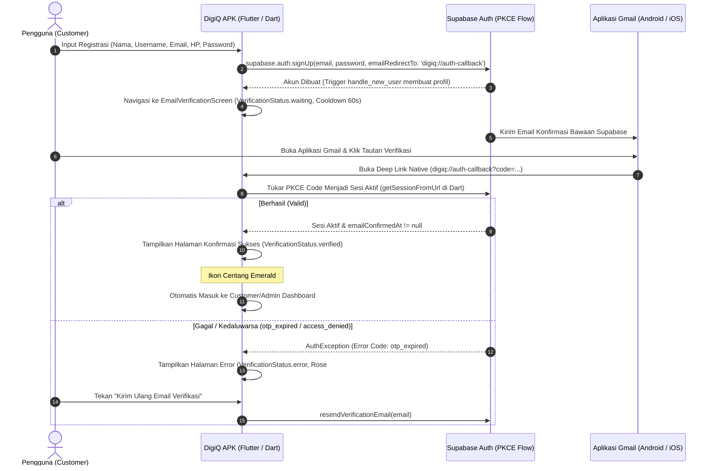

# Modul 08: Verifikasi Email (Gmail), Konfirmasi Callback, & Deep Link Murni Dart

## Ringkasan Eksekutif
Modul ini mengimplementasikan alur verifikasi email registrasi (Sign Up) pengguna DigiQ secara **100% murni berbasis Dart (Flutter Widgets)** tanpa file atau template HTML eksternal. Alur ini memanfaatkan protokol **Supabase PKCE (Proof Key for Code Exchange)** dan custom scheme deep link native (`digiq://auth-callback`). Ketika pengguna menekan tautan verifikasi di aplikasi Gmail, Android langsung membuka kembali aplikasi DigiQ, menukar token di sisi client Dart secara aman, dan menampilkan halaman konfirmasi visual responsif (`EmailVerificationScreen`) dengan animasi status dan pengalihan otomatis ke Beranda.

---

## 1. Arsitektur & Diagram Alur 100% Dart

---

## 2. Daftar Berkas Dibuat & Dimodifikasi (100% Dart)

| Berkas | Jenis Aksi | Deskripsi Perubahan |
| :--- | :---: | :--- |
| [android/app/src/main/AndroidManifest.xml](file:///d:/PROJEK%20FAN%20DEV/digiq/android/app/src/main/AndroidManifest.xml) | Modifikasi | Konfigurasi `launchMode="singleTop"` dan penambahan `<intent-filter>` untuk scheme `digiq` dengan host `auth-callback`. |
| [ios/Runner/Info.plist](file:///d:/PROJEK%20FAN%20DEV/digiq/ios/Runner/Info.plist) | Dibuat | Penambahan `CFBundleURLTypes` dengan `CFBundleURLSchemes` bernilai `digiq` untuk konsistensi platform iOS. |
| [lib/services/auth_service.dart](file:///d:/PROJEK%20FAN%20DEV/digiq/lib/services/auth_service.dart) | Modifikasi | Penambahan konstanta `kAuthRedirectUri = 'digiq://auth-callback'`, integrasi `emailRedirectTo` pada `signUp`, fungsi `resendVerificationEmail(email)`, helper `isCurrentUserEmailVerified`, serta penerjemahan error `otp_expired`, `rate_limit`, dan `access_denied`. |
| [lib/services/deep_link_auth_handler.dart](file:///d:/PROJEK%20FAN%20DEV/digiq/lib/services/deep_link_auth_handler.dart) | Dibuat | Handler Dart penangkap deep link melalui `detectSessionInUriPredicate`, pemantauan flag sukses verifikasi dan parameter error deep link. |
| [lib/services/supabase_config.dart](file:///d:/PROJEK%20FAN%20DEV/digiq/lib/services/supabase_config.dart) | Modifikasi | Mengaktifkan `authFlowType: AuthFlowType.pkce` dan `detectSessionInUri: true` secara eksplisit di Dart. |
| [lib/screens/auth/email_verification_screen.dart](file:///d:/PROJEK%20FAN%20DEV/digiq/lib/screens/auth/email_verification_screen.dart) | Modifikasi | Layar verifikasi visual modern 100% Dart dengan 3 status (`waiting`, `verified`, `error`), cooldown 60s, auto-countdown 3s, dan pembersihan timer/subscription pada `dispose()`. |
| [lib/screens/auth_gate_screen.dart](file:///d:/PROJEK%20FAN%20DEV/digiq/lib/screens/auth_gate_screen.dart) | Modifikasi | Pengarah navigasi utama yang mendeteksi transisi verifikasi email (cold start / resume) dan menampilkan layar konfirmasi sukses terlebih dahulu selama 3 detik. |
| [lib/screens/register_screen.dart](file:///d:/PROJEK%20FAN%20DEV/digiq/lib/screens/register_screen.dart) | Modifikasi | Menghubungkan alur pendaftaran sukses langsung ke `EmailVerificationScreen(initialStatus: VerificationStatus.waiting)`. |
| [lib/screens/login_screen.dart](file:///d:/PROJEK%20FAN%20DEV/digiq/lib/screens/login_screen.dart) | Modifikasi | Menyediakan aksi tombol snackbar "Verifikasi" jika user mencoba login saat email belum dikonfirmasi. |
| [lib/main.dart](file:///d:/PROJEK%20FAN%20DEV/digiq/lib/main.dart) | Modifikasi | Mendaftarkan `navigatorKey: DeepLinkAuthHandler.navigatorKey` untuk routing global. |

---

## 3. Spesifikasi Tiga Tampilan Layar Dart (`EmailVerificationScreen`)

### 1. Tampilan 1 — Menunggu Verifikasi (`VerificationStatus.waiting`)
- **Aksen Visual**: Ikon amplop `Icons.mark_email_unread_outlined` di dalam lingkaran Cyan `#06ACDC` dengan background `#E0F2FE`.
- **Judul**: `"Cek Gmail Anda"`.
- **Pesan**: Memberikan instruksi spesifik kepada pengguna untuk membuka Gmail dan menekan tautan aktivasi yang dikirimkan.
- **Deteksi Real-Time**: Listener Dart `AuthService.authStateChanges` memantau event `signedIn` atau `emailConfirmedAt != null`. Begitu tautan diklik di browser atau Gmail, aplikasi langsung beralih secara otomatis ke tampilan konfirmasi sukses tanpa mengharuskan pengguna me-refresh aplikasi manual.
- **Anti-Spam Cooldown**: Tombol *"Kirim Ulang Email Verifikasi"* dibekali penghitung mundur 60 detik (`"Kirim ulang dalam 59d..."`) guna melindungi endpoint autentikasi dari rate-limit Supabase.
- **Tombol Sekunder**: *"Kembali ke Halaman Login"*.

### 2. Tampilan 2 — Halaman Konfirmasi Sukses Saat Kembali ke APK (`VerificationStatus.verified`)
- **Aksen Visual**: Ikon centang besar `Icons.check_circle_rounded` berwarna Emerald `#10B981` dengan background `#D1FAE5`.
- **Judul**: `"Email Berhasil Diverifikasi!"`.
- **Subjudul**: `"Selamat datang di DigiQ. Akun Anda telah aktif dan siap digunakan."`
- **Auto-Redirect Visual**: Menampilkan animasi progress dan badge hitung mundur 3 detik (`"Mengalihkan ke Beranda dalam 3 detik..."`) yang otomatis mengarahkan pengguna ke halaman Home/Katalog (Customer) atau Admin Dashboard sesuai role (`Navigator.of(context).pushAndRemoveUntil(...)`).
- **Tombol Utama**: *"Masuk ke Aplikasi Sekarang"* (ElevatedButton Cyan `#06ACDC`) untuk pengguna yang ingin langsung berpindah seketika tanpa menunggu countdown timer selesai.

### 3. Tampilan 3 — Halaman Gagal / Link Kedaluwarsa (`VerificationStatus.error`)
- **Aksen Visual**: Ikon peringatan `Icons.warning_amber_rounded` berwarna Rose `#E11D48` dengan background `#FFE4E6`.
- **Judul**: `"Tautan Kedaluwarsa / Tidak Valid"`.
- **Pesan**: Menerjemahkan kode error Supabase (`otp_expired`, `access_denied`, dll.) ke pesan Bahasa Indonesia yang komunikatif dan jelas.
- **Form Pemulihan**: Kolom teks email aktif dan tombol *"Kirim Ulang Email Verifikasi"* untuk meminta token aktivasi baru seketika.

---

## 4. Panduan Konfigurasi Supabase Dashboard

Untuk mengaktifkan alur verifikasi email dan deep link secara penuh, ikuti langkah berikut di **Supabase Dashboard**:

1. Buka **Supabase Dashboard** ➔ Proyek DigiQ.
2. Navigasi ke menu **Authentication** ➔ **URL Configuration**.
3. Pada bagian **Redirect URLs**, klik **Add URL** dan daftarkan:
   - `digiq://auth-callback` *(Wajib untuk custom scheme deep link APK DigiQ)*
   - `digiq://login-callback` *(Untuk OAuth Google/Gmail)*
4. Klik **Save**.
5. Tidak diperlukan file HTML eksternal atau web bridge hosting; seluruh penukaran token dan tampilan UI ditangani 100% oleh Flutter di dalam APK.

---

## 5. Ringkasan Kualitas & Integritas Kode
- **Analisis Statis**: `flutter analyze` menghasilkan **0 error** dan **0 warning**.
- **Manajemen Memori**: Seluruh `StreamSubscription<AuthState>`, `StreamSubscription<Uri>`, `Timer` cooldown & redirect, serta `TextEditingController` di-`cancel()` dan di-`dispose()` secara ketat pada metode `dispose()`.
- **Zero-Trust Security**: Menggunakan PKCE flow native Supabase tanpa transmisi token secara plain-text.
